# Apple Pay tax update failures: problems and fixes

This is an overview of how Checkout's Apple Pay flow handles a failed tax update while the sheet is open.
It covers what goes wrong today and in [#7697](https://github.com/stripe/stripe-ios/pull/7697), why, and a proposed fix.
Every claim about Apple Pay's behavior was checked on the iOS 18.5 simulator against the playground backend. The screenshots are in [`screenshots/`](screenshots).

- **Fix:** branch [`yuki/fix-apple-pay-tax-update-recovery`](https://github.com/stripe/stripe-ios/compare/joyceqin/fix-apple-pay...yuki/fix-apple-pay-tax-update-recovery), stacked on #7697. The diff is in [`fix.diff`](fix.diff).
  I closed that PR because it was opened by mistake. Take whatever is useful into #7697.
- **Experiments:** this branch. It adds instrumentation behind `APPLEPAY_EXPERIMENT` and `ApplePayExperimentUITests.swift`, which drives the Apple Pay sheet. Not for merging.

---

## 1. Background: how tax updates work while the sheet is open

When automatic tax uses the buyer's address, `CheckoutApplePayContext` updates the Checkout Session's tax region
(`checkout_client/<id>/update` with `tax_region[...]`) as the buyer picks things in the sheet. It then sends Apple the new summary items:

| Buyer action | Delegate callback | Address it gets | Can it change the sheet's totals? |
|---|---|---|---|
| Picks or edits a shipping address | `didSelectShippingContact` | Redacted shipping address | **Yes**, through the handler |
| Picks a card (billing-sourced tax) | `didSelectPaymentMethod` | Redacted billing address: city, state, ZIP, country. No street. | **Yes**, through the handler |
| Taps Pay | `didAuthorizePayment` | Full billing and shipping contacts | **No.** `PKPaymentAuthorizationResult` has no summary items |

Two more facts shape everything below:

- **Confirm sends `expectedAmount: checkoutSession.amount`** (`CheckoutApplePayContext.swift`, `didAuthorizePayment`), and the server rejects a mismatch with
  `checkout_expected_amount_does_not_match_amount_due`. The server compares against the client's session. It knows nothing about what the sheet showed.
  So if the client session changes after the sheet's totals were last updated, the server will accept a total the buyer never saw.
- **`STPAPIClient` only retries HTTP 429** ([`URLSession+Retry.swift:19`](https://github.com/stripe/stripe-ios/blob/master/StripeCore/StripeCore/Source/Helpers/URLSession%2BRetry.swift#L19)).
  A network blip or a 5xx fails the tax update on the first try.

## 2. What Apple Pay actually does

Apple's docs don't describe most of this, and in one case they're wrong. Everything here was seen in the simulator.

### Billing (`didSelectPaymentMethod` / `didAuthorizePayment`)

| What we return | What the buyer sees | Screenshot |
|---|---|---|
| Any error in `PKPaymentRequestPaymentMethodUpdate(errors:)` | **Ignored.** No error, Pay stays enabled. This contradicts [Apple's docs](https://developer.apple.com/documentation/passkit/pkpaymentrequestpaymentmethodupdate/init(errors:paymentsummaryitems:)) |  |
| ...and then the buyer pays the stale total | The server rejects it: "$120.00 does not match … $131.70" | 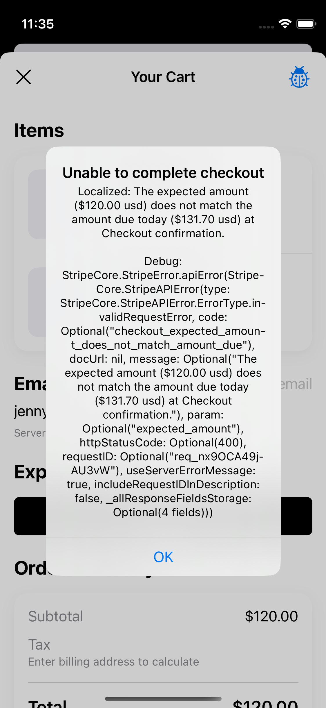 |
| `.failure` with `paymentBillingAddressInvalidError` (what #7697 does) | The sheet stays open. The card turns red, and Pay becomes "Update Billing Address" |  |
| ...and the buyer opens the card | **Our `localizedDescription` is shown**, here the raw server message | 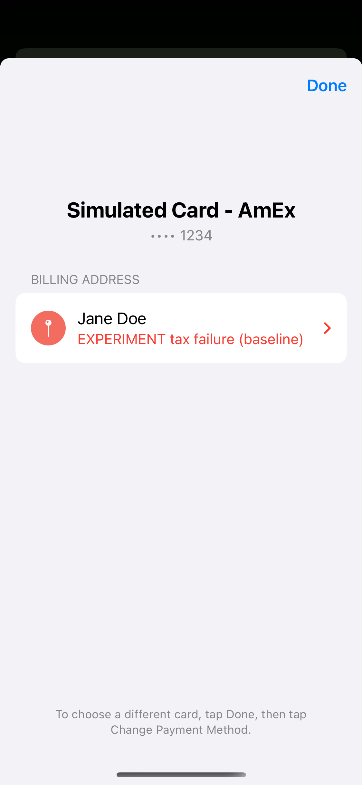 |
| ...and the buyer opens the billing editor | The ZIP is red and **Done stays disabled** until a field changes. Retyping the same ZIP doesn't enable it | 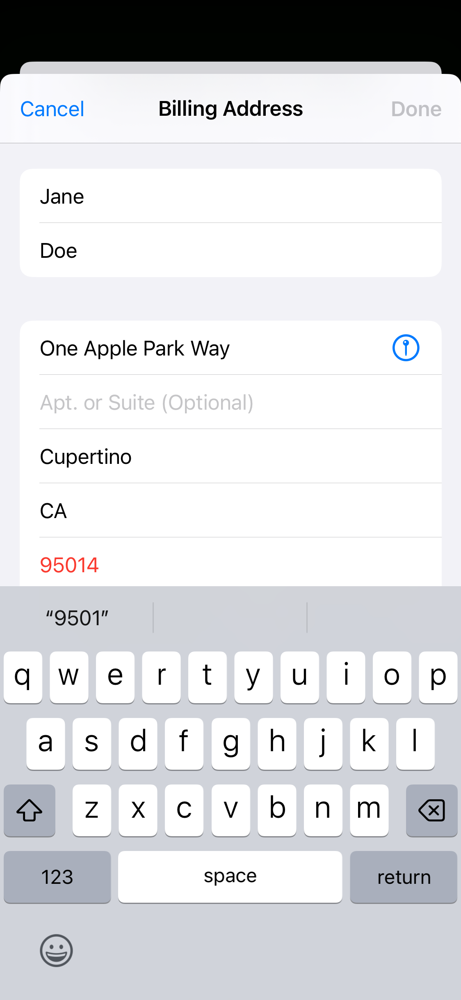 |
| ...and the buyer re-selects the same card | **`didSelectPaymentMethod` is not called again** | 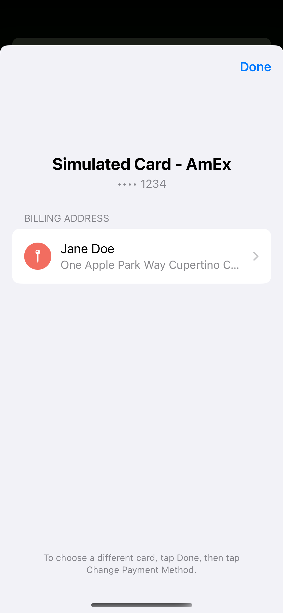,  |
| `.failure` with `errors: nil` | **The sheet closes.** The app gets "Canceled" |  |
| `.failure` with a non-PassKit error (also what the confirm path does for non-ZIP errors) | **The sheet closes.** The app gets "Canceled" | 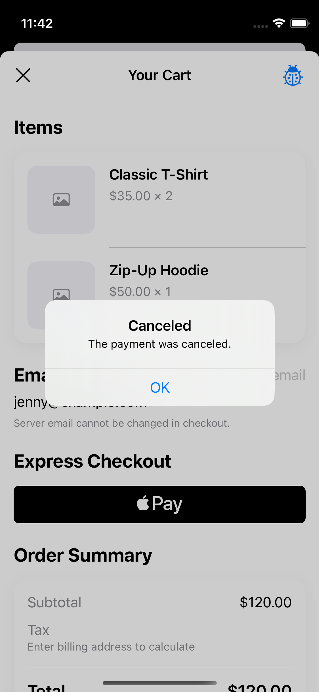 |
| `.failure` with `PKPaymentErrorDomain` / `.unknownError` | **The sheet stays open.** No field marked, and Pay can be tapped again |  |

### Shipping (`didSelectShippingContact`)

| Error in `PKPaymentRequestShippingContactUpdate(errors:)` | What the buyer sees | Screenshot |
|---|---|---|
| `paymentShippingAddressUnserviceableError` | A system alert: **"<App> Doesn't Ship to Your Shipping Address"** | 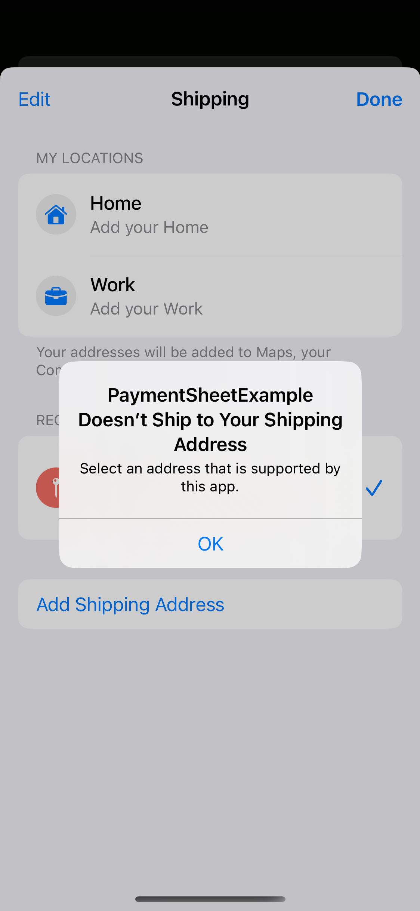 |
| `PKPaymentErrorDomain` / `.unknownError` | **Ignored.** Pay stays enabled with the stale total |  |
| `paymentContactInvalidError(.postalAddress)` | "Update Shipping Address", Pay blocked, no field marked | 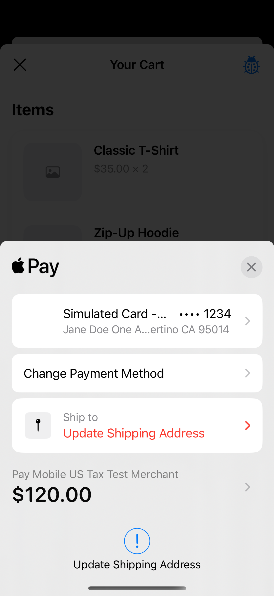 |
| ...and the buyer opens the address list | Our `localizedDescription` appears under the address | 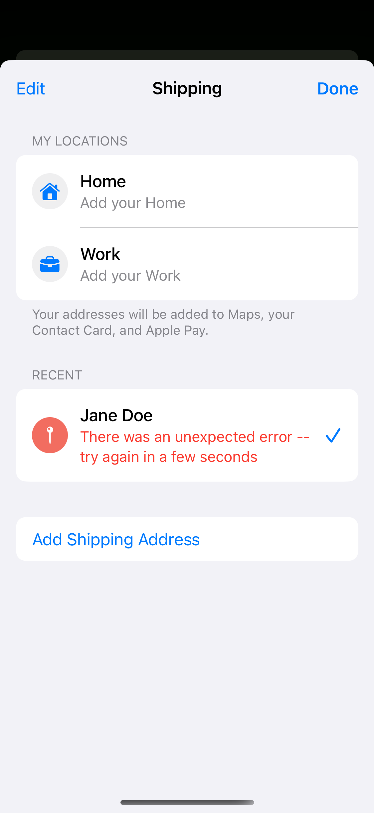 |
| ...and the buyer re-saves the same address and taps Done | **`didSelectShippingContact` is called again**, unlike billing. The buyer can recover inside the sheet | 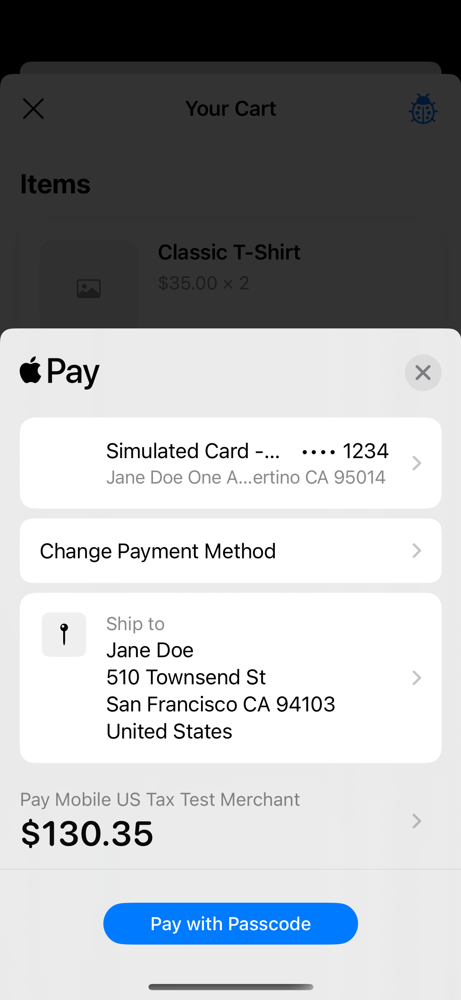 |

### The server

I sent the update endpoint deliberately bad addresses. **None were rejected:**

| `tax_region` sent | Result |
|---|---|
| `postal_code=00000` | Succeeded, $0 tax |
| `country=ZZ` | Succeeded, $0 tax |
| `state=ZZ` | Succeeded, normal tax |

So a tax update that fails while the sheet is open is almost always a network, server or session problem, **not the buyer's address**.
(Address problems can still surface at confirm as `customer_tax_location_invalid`, per the comment in `CheckoutElementsUITests`.)

## 3. The problems

### Before #7697

1. **Failures were silently swallowed.** The sheet kept the pre-tax total. The buyer could tap Pay, and the server then rejected the stale amount, closing the sheet with an error.
   This was never a safety issue, because the server's expected-amount check holds, but the experience is bad.

### In #7697

2. **Every failure is blamed on the ZIP.** Billing and shipping both return `…AddressInvalidError(withKey: CNPostalAddressPostalCodeKey)`, even for a network error.
   Given the server findings above, that's misleading in nearly every real case.
3. **A transient billing failure is permanent.** `paymentMethodUpdateTask` keeps the failed `Task`, and a failed `Task.value` rethrows the same error forever.
   The task is only replaced in `didSelectPaymentMethod`, which Apple won't call again for the same card. The editor won't save an unchanged address either ([10](screenshots/10-billing-editor-done-disabled.png)).
   So the buyer's only ways out are to change their address, pick another card, or cancel.
4. **The raw server message is shown to buyers.** `error.nonGenericDescription` is the server's `message`, because Checkout sets `useServerErrorMessage`.
   It isn't localized by the client, and it appears in Apple's otherwise localized sheet ([09](screenshots/09-card-details-shows-our-message.png)).
   The fix always shows the localized generic message instead.
5. **Two explanations in #7697 need correcting:**
   - The PR description says the billing address isn't available until authorization. It is available in `didSelectPaymentMethod`, redacted, and the PR's own code uses it.
     The real reason errors have to go at authorization is that Apple ignores errors from `didSelectPaymentMethod`.
   - The code comment "instead of letting the customer pay stale totals" overstates the risk, because the server already blocks that. The real benefit is UX.

### Why the sheet can't always recover on its own

At authorization the full billing address is available, so retrying the update there works mechanically.
But the sheet still shows the pre-tax $120, and a successful retry produces $131.70.
Apple can't show the new total after Pay is tapped, so the code has to choose:
- Confirm, which charges an amount the buyer never saw. The server won't catch this, because the client session now matches it.
- Fail and keep the sheet open, which leaves the buyer stuck ([08](screenshots/08-still-stale-120-after-reselect.png)). Re-selecting the same card doesn't call `didSelectPaymentMethod` again.
- Close the sheet, so the next Apple Pay attempt starts from the new total.

The fix closes the sheet.

## 4. The fix

All of it lives in `CheckoutApplePayContext` ([`fix.diff`](fix.diff)).
Nothing retries on its own. The buyer retries by tapping Pay again or by saving the shipping address again.
No failure is blamed on a specific address field, because the update endpoint accepted every bad address I tried. The buyer always sees the localized generic message, "There was an unexpected error -- try again in a few seconds".

### Billing, in plain steps

These are the real numbers from the simulator: a $120 cart where billing tax should bring the total to $131.70.

**Setup: the update fails while the buyer is picking a card.**

1. The buyer opens Apple Pay and picks a card.
2. We ask the server to recalculate tax for that card's billing address, and the request fails, say because of a network blip.
3. We can't put an error on the sheet at this point, because Apple ignores errors returned here ([screenshot 02](screenshots/02-pm-update-error-ignored.png)). So the sheet keeps showing **$120**, with no tax, and looks completely normal.
4. We remember that the tax update failed.

**Then the buyer taps Pay.**
This is the next point where our code runs (`retryFailedBillingTaxUpdate(payment:)`). We see the earlier failure and send the same tax request once more, this time with the full billing address Apple provides at authorization. One of three things happens.

**A. The request fails again** (still offline).
- We tell Apple "payment failed" with a generic `PKPaymentErrorDomain` / `.unknownError` error.
- That keeps the sheet open, marks no address field and shows no misleading message.
- The buyer can tap Pay again, which tries once more, or cancel.

**B. The request succeeds and the total is still $120.**
- This happens when tax comes out to $0 for that address.
- The buyer saw $120 and is charged $120, so we go ahead with the payment.

**C. The request succeeds and the total is now $131.70.**
- The sheet still says $120, and Apple doesn't let us change the amount once Pay has been tapped.
- If we confirmed now, we'd charge $131.70 for a sheet that said $120. The server wouldn't stop this, because our session now says $131.70 too.
- So we close the sheet and return a failure, `CheckoutError.totalChanged`, shown with the generic message.
- The buyer taps Apple Pay again. The sheet now shows **$131.70**, since the session already has the right total, and they pay.

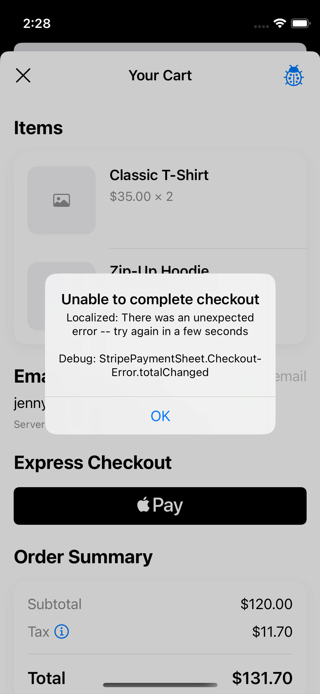 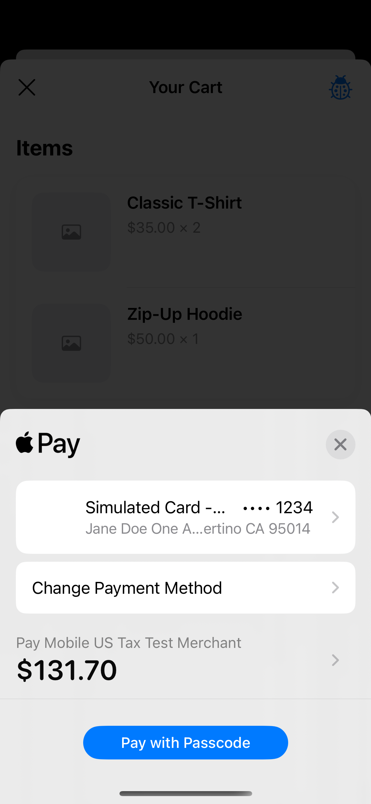 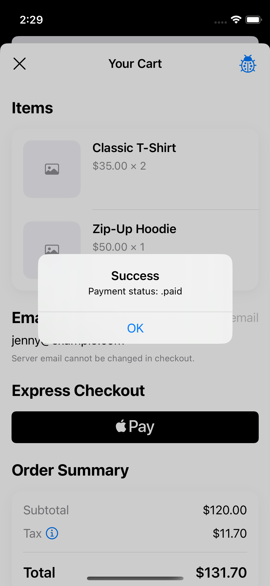

Option C is the clunky one, because the buyer has to open Apple Pay a second time.
But it's the only honest choice: the sheet's amount can't be updated after Pay is tapped, and we don't want to charge a number the buyer never saw.

### Shipping, in plain steps

Shipping is simpler, because Apple calls `didSelectShippingContact` again when the buyer saves the address.

1. The buyer picks a shipping address, and the tax update fails.
2. We return `paymentContactInvalidError(withContactField: .postalAddress)` with the generic message.
   The sheet says "Update Shipping Address" and blocks Pay, without marking a field.
   We use this error because the alternatives are worse:
   - An unserviceable error pops up "<App> Doesn't Ship to Your Shipping Address".
   - A generic PassKit error is ignored, and Pay stays enabled with the stale total.
3. The buyer opens the address and saves it again. Apple calls `didSelectShippingContact`, and the update runs again.
4. If it succeeds, the sheet shows the new total, in the simulator $130.35, and the buyer pays.

  

### What the fix leaves alone

- The confirm path's `pkPaymentError(forStripeError:)` still passes non-ZIP errors through as non-PassKit errors, so the sheet closes. That's existing behavior.
- Genuine address problems still surface at confirm, for example as `customer_tax_location_invalid`, through the existing confirm error path.

## 5. Verification

**Unit tests:** all 39 `CheckoutApplePayContextTests` pass. New tests cover:
- a failed shipping tax update flagging the address without marking a field, with the generic message;
- tapping Pay when the billing update keeps failing: the sheet stays open without marking a field;
- tapping Pay when the retried billing update keeps the total: the payment confirms, using the billing address from authorization;
- tapping Pay when the retried billing update changes the total: the sheet closes and reports a total-changed failure.

**Simulator, real backend, with network failures forced in the experiment build:**

| Scenario | Result | Screenshots |
|---|---|---|
| Billing update keeps failing | The sheet stays open after two Pay taps, with no field marked |  |
| Billing fails in the sheet, then succeeds at authorization with a new total | The sheet closes with the generic error. Reopening shows $131.70, and payment completes |    |
| Shipping fails in the sheet | The address shows the generic message. Re-saving it re-runs the update, the sheet shows $130.35, and payment completes |   |

These runs were on an earlier version of the fix, which also retried twice automatically inside the sheet.
Each run forced enough failures to use up those retries, so the flows shown are the ones the current code takes. I haven't re-run them on the final code.
That earlier version's in-sheet retry, which brought the sheet to $131.70 with no buyer action, is in [screenshot 15](screenshots/15-fix-in-sheet-retry-shows-taxed-total.png) for reference.

## 6. Open questions

- **Real device.** Everything above is from one simulator runtime with simulated cards.
- **Should a total-changed retry close the sheet, or keep it open?** Closing means a second Apple Pay tap. Keeping it open strands the buyer, so I chose closing.
- **`CheckoutError.invalidShippingCountry`** is still passed to Apple as a non-PassKit error with an English message. `paymentShippingAddressUnserviceableError` is the right error for that case. Not touched here.
- **Should field-level address errors come back?** The update endpoint never returned one in testing, so the fix doesn't try to map server errors to address fields.
  If the Checkout backend confirms a field-level error contract, marking the field could be added then.
- **Should transient failures retry automatically inside the sheet?** That would avoid option C in most network blips, at the cost of a slower sheet. The fix leaves retrying to the buyer.

## 7. stripe-android, for comparison

At [`1516eff`](https://github.com/stripe/stripe-android/tree/1516eff22098d2d13c4840b4d870688f10979583):

- **ECE Google Pay updates tax while the sheet is open**
  ([`CheckoutGooglePayPaymentDataUpdateCallback.kt:82-135`](https://github.com/stripe/stripe-android/blob/1516eff22098d2d13c4840b4d870688f10979583/paymentsheet/src/main/java/com/stripe/android/checkout/CheckoutGooglePayPaymentDataUpdateCallback.kt#L82-L135)):
  - **No stuck state.** Each callback sends a fresh request.
  - **Messages are localized** by the client (`stripeErrorMessage(context)`).
  - **Billing failures mark no field** (`OTHER_ERROR`). Shipping failures, including network errors, use `SHIPPING_ADDRESS_INVALID`.
- **Payment Element Google Pay doesn't update tax while the sheet is open.** With billing-sourced tax, the billing address is sent at confirm, after the sheet closes
  ([`CheckoutSessionConfirmationInterceptor.kt:94-125`](https://github.com/stripe/stripe-android/blob/1516eff22098d2d13c4840b4d870688f10979583/paymentsheet/src/main/java/com/stripe/android/paymentelement/confirmation/intent/CheckoutSessionConfirmationInterceptor.kt#L94-L125)).
  - If the total changed, confirm fails locally with `checkout_session_total_changed` and the generic message. That's intentional and tested
    ([`CheckoutPaymentElementAnalyticsTest.kt:202-246`](https://github.com/stripe/stripe-android/blob/1516eff22098d2d13c4840b4d870688f10979583/paymentsheet/src/androidTest/java/com/stripe/android/checkout/CheckoutPaymentElementAnalyticsTest.kt#L202-L246)).
  - This is the same "close and try again" approach as iOS fix step 3.
- **Unverified lead from a code read:** the ECE in-sheet update may not write the new session back to the controller state, so confirm could send a stale `expected_amount`.

## Reproducing

1. Check out this branch and set `APPLEPAY_EXPERIMENT` in the `ApplePayExperimentUITests` launch environment.
   Variants: `baseline`, `pmupdate_billing`, `pmupdate_unknown`, `retry`, `retry_unknown`, `retry_plain`, `realbad_zip`, `realbad_state`, `realbad_country`.
2. Run, for example: `ci_scripts/run_tests.rb --ui --test PaymentSheetUITest/ApplePayExperimentUITests/testExperimentBaseline`
3. Screenshots and element trees go to `/tmp/apexp-out/<variant>/`. The delegate log (`APEXP …`) is in the simulator log, and [`delegate-log.txt`](delegate-log.txt) has the original runs.
