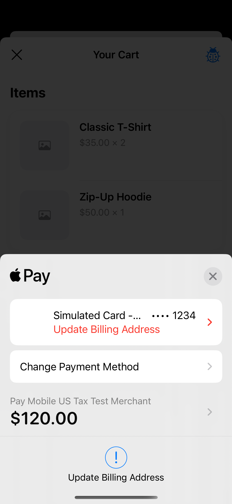

# Apple Pay tax update failures: simulator experiments for #7697

Context: [stripe-ios#7697](https://github.com/stripe/stripe-ios/pull/7697) ("Surface Apple Pay tax update errors in sheet").
The PR reports a failed billing tax update at authorization with `paymentBillingAddressInvalidError(CNPostalAddressPostalCodeKey)`,
and a failed shipping tax update with `paymentShippingAddressInvalidError(CNPostalAddressPostalCodeKey)`.

This branch is the PR head plus throwaway instrumentation, controlled by the `APPLEPAY_EXPERIMENT` launch environment variable
(`CheckoutApplePayContext.swift`), and a UI test that drives the Apple Pay sheet (`ApplePayExperimentUITests.swift`).
**None of this code is meant to merge.**

- Environment: iOS 18.5 simulator (22F77), Xcode 27.2, simulated AmEx card, Checkout Playground (ECE-only, automatic tax from billing, no shipping).
- The tax update failure is forced client-side. The first failure in the retry experiments wraps `URLError(.notConnectedToInternet)`.
- Raw delegate log: [`delegate-log.txt`](delegate-log.txt). The `(no errors)` text in the `retry_unknown` and `retry_plain` lines is stale log wording; those variants did pass an error.

## TL;DR

1. **Apple ignores errors returned from `didSelectPaymentMethod`.** That's why the PR reports billing errors at authorization, and that part is right.
   The PR's stated reason ("billing address isn't available until authorization") is wrong: the redacted address (city/state/ZIP/country) does arrive in `didSelectPaymentMethod`.
2. **A transient failure leaves the buyer stuck with the PR as written.** The sheet tells them to "Update Billing Address" even though it's valid,
   and tapping Pay again re-awaits the same failed `Task`, so the request is never re-sent.
3. **Retrying at authorization can't fix it.** The sheet still shows the pre-tax total, `PKPaymentAuthorizationResult` can't update summary items,
   and re-selecting the same card doesn't call `didSelectPaymentMethod` again. A successful retry changes a total the buyer can't see.
4. **`.failure` with no errors, or with a non-PassKit error, closes the sheet.** Only a `PKPaymentErrorDomain` error keeps it open.
   `.unknownError` keeps it open without marking any field.
5. **The server already rejects stale totals** (`checkout_expected_amount_does_not_match_amount_due`), so the PR improves UX, not safety.

## Results

### 1. The PR's approach: billing error at authorization



The sheet stays open, but the card row turns red and Pay is replaced with **"Update Billing Address"**.
Our `localizedDescription` isn't shown on this screen; Apple shows its own localized text. I didn't check the billing editor screen.

### 2. Errors returned from `didSelectPaymentMethod` are ignored

Variants `pmupdate_billing` (`paymentBillingAddressInvalidError`) and `pmupdate_unknown` (`PKPaymentErrorDomain`/`.unknownError`),
both returned via `PKPaymentRequestPaymentMethodUpdate(errors:paymentSummaryItems:)`:

| Sheet after the update: no error, Pay enabled | After Pay: the server rejects the stale amount |
|---|---|
|  |  |

This contradicts [Apple's docs](https://developer.apple.com/documentation/passkit/pkpaymentrequestpaymentmethodupdate/init(errors:paymentsummaryitems:))
("Use the errors array to specify any errors in the payment method that the user must resolve").
The server error shows that confirm sends an expected amount and the server refuses it when it doesn't match:
`checkout_expected_amount_does_not_match_amount_due`, "$120.00 … does not match … $131.70".

### 3. Which authorization failures keep the sheet open?

| `.failure`, `errors: nil` | `.failure`, plain non-PassKit `NSError` | `.failure`, `PKPaymentErrorDomain` / `.unknownError` |
|---|---|---|
|  |  |  |
| Sheet closes and the app gets "Canceled" | Sheet closes and the app gets "Canceled" | Sheet stays open. No field marked, Pay re-enabled, no visible message |

Note: the plain-error column is also what the existing confirm path does for non-ZIP errors,
since `STPAPIClient.pkPaymentError(forStripeError:)` passes them through unchanged.

### 4. Retrying at authorization (with `.unknownError` so the sheet stays open)

```
select#1: forcing network failure
select#1: handler called, displayed total=Optional(120)
auth#1: previousUpdateFailed=true            -> .failure (.unknownError)
auth#2: retrying tax update with billingContact <… One Apple Park Way, Cupertino, CA 95014 …>
auth#2: retry succeeded. displayed=Optional(120) new=Optional(131.7)
auth#2: total changed                         -> .failure (.unknownError)
        [test taps the card row, taps the same card, taps Done — no didSelectPaymentMethod call]
auth#3: totals on sheet are stale             -> .failure (.unknownError)
auth#4: totals on sheet are stale             -> .failure (.unknownError)
```

| Re-selecting the same card | Still $120 afterwards |
|---|---|
|  |  |

The retry works mechanically (the full billing contact is available at authorization), but it can't help.
The sheet still says $120, and confirming would charge $131.70. The server wouldn't catch that, because the client session would then match the server.

## What this means for the fix

- The only callback that can update the totals is `didSelectPaymentMethod`, before it calls `handler`.
  Retry transient failures there, with a short bounded backoff (Apple times out the handler; I didn't measure the limit).
- Only return `paymentBillingAddressInvalidError` / `paymentShippingAddressInvalidError` when the API says the address is the problem
  (`param` is `tax_region[...]`, or the code is `customer_tax_location_invalid`), and map `param` to the matching `CNPostalAddress*Key` instead of always using the postal code.
- For any other failure, return a `PKPaymentErrorDomain`/`.unknownError` error at authorization (not `nil`, which closes the sheet).
  Retry the update there too, and confirm only if the total is unchanged.
- **Not tested, and possibly decisive:** whether "Update Billing Address" → re-saving the same address fires `didSelectPaymentMethod`.
  If it does, the PR's error is a working (if misleadingly worded) way to recover in-sheet. Also not tested: "Change Payment Method", the shipping path, and a real device.

## stripe-android comparison

At [`1516eff`](https://github.com/stripe/stripe-android/tree/1516eff22098d2d13c4840b4d870688f10979583):

- **ECE Google Pay updates tax while the sheet is open**, through
  [`CheckoutGooglePayPaymentDataUpdateCallback.kt:82-135`](https://github.com/stripe/stripe-android/blob/1516eff22098d2d13c4840b4d870688f10979583/paymentsheet/src/main/java/com/stripe/android/checkout/CheckoutGooglePayPaymentDataUpdateCallback.kt#L82-L135):
  - Each callback sends a fresh request, so there's no cached failure and no stuck-retry problem.
  - The message is client-localized (`error.stripeErrorMessage(context)`).
  - Billing failures use `OTHER_ERROR`, which marks no field. Shipping failures use `SHIPPING_ADDRESS_INVALID`, even for network errors.
- **Payment Element Google Pay does not update tax while the sheet is open.** It uses `GooglePayPaymentDataUpdateNoOpModule`.
  With billing-sourced tax, the billing address is only sent at confirm, after the sheet closes, in
  [`CheckoutSessionConfirmationInterceptor.kt:94-125`](https://github.com/stripe/stripe-android/blob/1516eff22098d2d13c4840b4d870688f10979583/paymentsheet/src/main/java/com/stripe/android/paymentelement/confirmation/intent/CheckoutSessionConfirmationInterceptor.kt#L94-L125).
  If the total changed, confirm fails locally with `checkout_session_total_changed` and the generic "Something went wrong".
  So **the first Google Pay attempt fails whenever billing tax changes the total.** That's intentional; see
  [`CheckoutPaymentElementAnalyticsTest.kt:202-246`](https://github.com/stripe/stripe-android/blob/1516eff22098d2d13c4840b4d870688f10979583/paymentsheet/src/androidTest/java/com/stripe/android/checkout/CheckoutPaymentElementAnalyticsTest.kt#L202-L246)
  ("Google Pay returns a new payment method, so its billing address is only synced to the Checkout Session during confirmation").
  Inferred, not verified: the session is refreshed after the failure, so a second attempt would show the taxed total and could succeed.
- Unverified lead from a code read: the ECE in-sheet update keeps the updated session in a local variable and doesn't write it back to the controller state.
  Confirm might then send a stale `expected_amount` when shipping tax changes the total.
